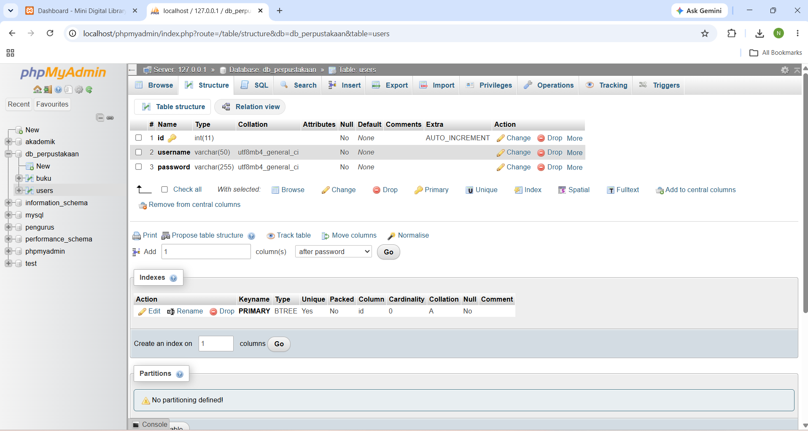
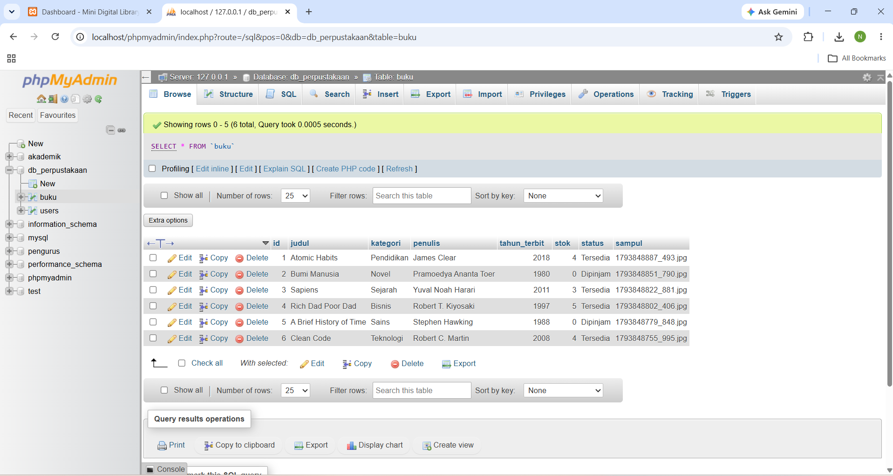
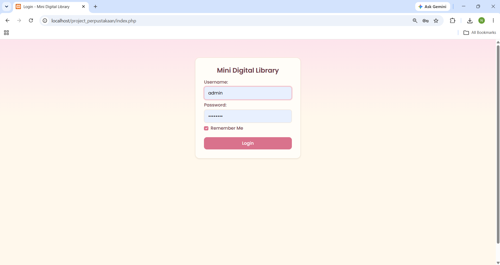
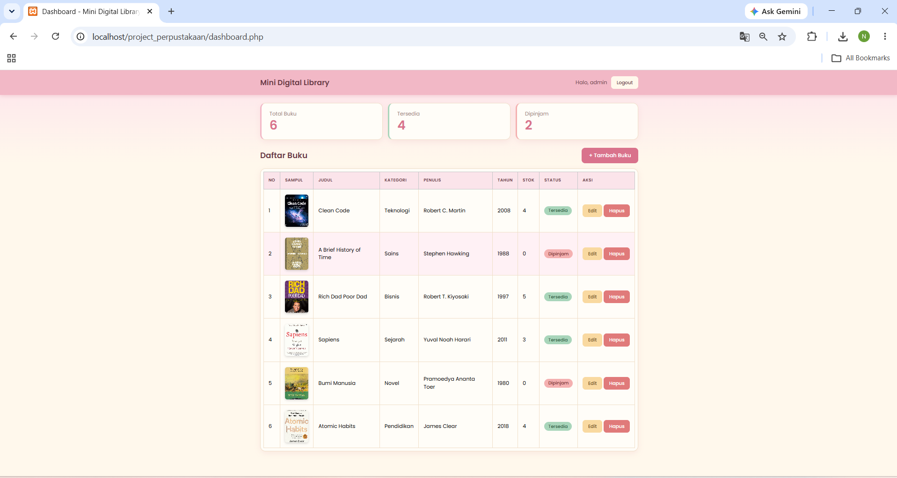
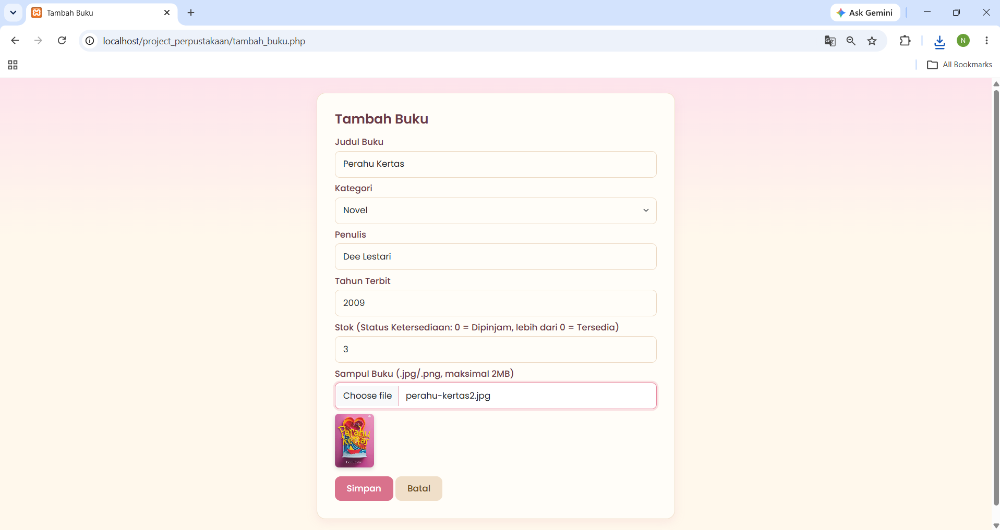
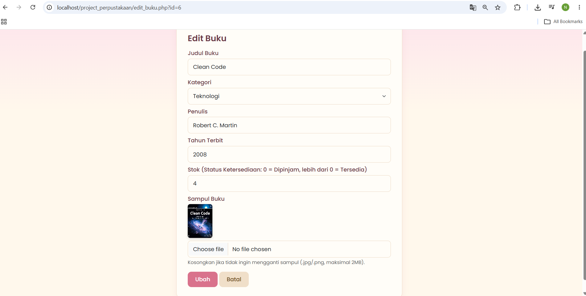
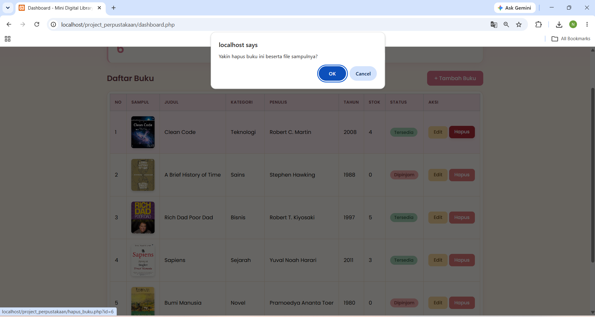

# Mini Digital Library

Aplikasi perpustakaan digital mini berbasis **PHP Native** dan **MySQL (mysqli)** dengan autentikasi, session, cookie, CRUD data buku, dan upload sampul buku.

**Tugas Terstruktur Mata Kuliah Pemrograman Web, Program Studi Sistem Informasi**

| | |
|---|---|
| Nama | AMARA DWI NATARIN |
| NIM | 2513020050 |
| Repositori | https://github.com/amaranatarin-arch/project-perpustakaan.git |
| Video Demo | ISI LINK YOUTUBE |

## Fitur

**Autentikasi dan hak akses**
- Login dengan form metode POST (username dan password).
- Dashboard dan pengelolaan buku hanya bisa diakses setelah login (session).
- "Remember Me" menyimpan username di cookie selama 30 hari.
- Logout menghapus session dan cookie, lalu kembali ke halaman login.

**CRUD data buku**
- **Create**: tambah buku (judul, kategori, penulis, tahun terbit, stok) beserta sampul.
- **Read**: daftar buku dalam tabel HTML dengan kartu statistik (total, tersedia, dipinjam).
- **Update**: ubah data buku dan ganti sampul (opsional).
- **Delete**: hapus data di database sekaligus file gambarnya di folder `uploads`.

**Upload file sampul**
- Hanya `.jpg`, `.jpeg`, dan `.png`, maksimal **2MB**.
- Validasi ekstensi, ukuran, dan isi file gambar.
- File lama otomatis dihapus saat sampul diganti atau buku dihapus.
- Preview gambar dan peringatan ukuran file dengan JavaScript.

**Logika bisnis**
- `if-else` menentukan status: stok lebih dari 0 berarti **Tersedia**, stok 0 berarti **Dipinjam**.
- `switch` menentukan warna badge status.
- Daftar kategori disimpan dalam array.

## Teknologi

- PHP Native (tanpa framework) dan MySQL dengan ekstensi `mysqli`
- Bootstrap 5 (CSS dan JS) dan JavaScript
- Git dan GitHub

## Struktur Folder

```
project_perpustakaan/
├── config/
│   ├── koneksi.php        # koneksi ke database MySQL
│   ├── cek_session.php    # proteksi halaman (wajib login)
│   └── fungsi.php         # status buku, kategori, upload dan hapus file
├── assets/
│   ├── css/
│   │   └── style.css      # tema pink dan cream
│   └── (gambar screenshot untuk README)
├── uploads/               # file sampul buku
├── index.php              # halaman login
├── proses_login.php       # verifikasi, session, dan cookie
├── logout.php             # hapus session dan cookie
├── dashboard.php          # tampil data (Read)
├── tambah_buku.php        # form tambah
├── proses_tambah.php      # insert dan upload file
├── edit_buku.php          # form edit
├── proses_edit.php        # update dan penggantian file
├── hapus_buku.php         # delete dan hapus file gambar
├── db_perpustakaan.sql    # ekspor database
└── README.md
```

## Cara Menjalankan

1. Pasang **XAMPP**, lalu jalankan **Apache** dan **MySQL**.
2. Salin folder proyek ke `C:\xampp\htdocs\project_perpustakaan`.
3. Buka `http://localhost/phpmyadmin`, klik tab **Import**, lalu pilih file `db_perpustakaan.sql` dan klik **Import**.
4. Jika user atau password MySQL berbeda dari bawaan XAMPP, sesuaikan `config/koneksi.php`.
5. Buka `http://localhost/project_perpustakaan/`.

**Akun login:** username `admin`, password `admin123`

## Struktur Tabel Database

Nama database: `db_perpustakaan`

### Tabel `users`

| Kolom | Tipe | Keterangan |
|---|---|---|
| id | INT | Primary key, auto increment |
| username | VARCHAR(50) | Nama pengguna |
| password | VARCHAR(255) | Disimpan dalam bentuk hash MD5 |

### Tabel `buku`

| Kolom | Tipe | Keterangan |
|---|---|---|
| id | INT | Primary key, auto increment |
| judul | VARCHAR(150) | Judul buku |
| kategori | VARCHAR(50) | Kategori buku |
| penulis | VARCHAR(100) | Nama penulis |
| tahun_terbit | INT | Tahun terbit |
| stok | INT | Jumlah stok (default 0) |
| status | VARCHAR(20) | Tersedia atau Dipinjam |
| sampul | VARCHAR(255) | Nama file sampul di folder `uploads` |




## Screenshot

### Halaman Login


### Dashboard (Read)


### Tambah Buku (Create dan Upload)


### Edit Buku (Update)


### Konfirmasi Hapus (Delete)


## Video Demo

Link video demo: ISI LINK YOUTUBE

## Catatan

- Password disimpan dengan MD5 agar sederhana untuk keperluan tugas. Untuk aplikasi sungguhan, gunakan `password_hash()`.
- Bootstrap dan font Poppins dimuat lewat CDN, jadi butuh koneksi internet.
